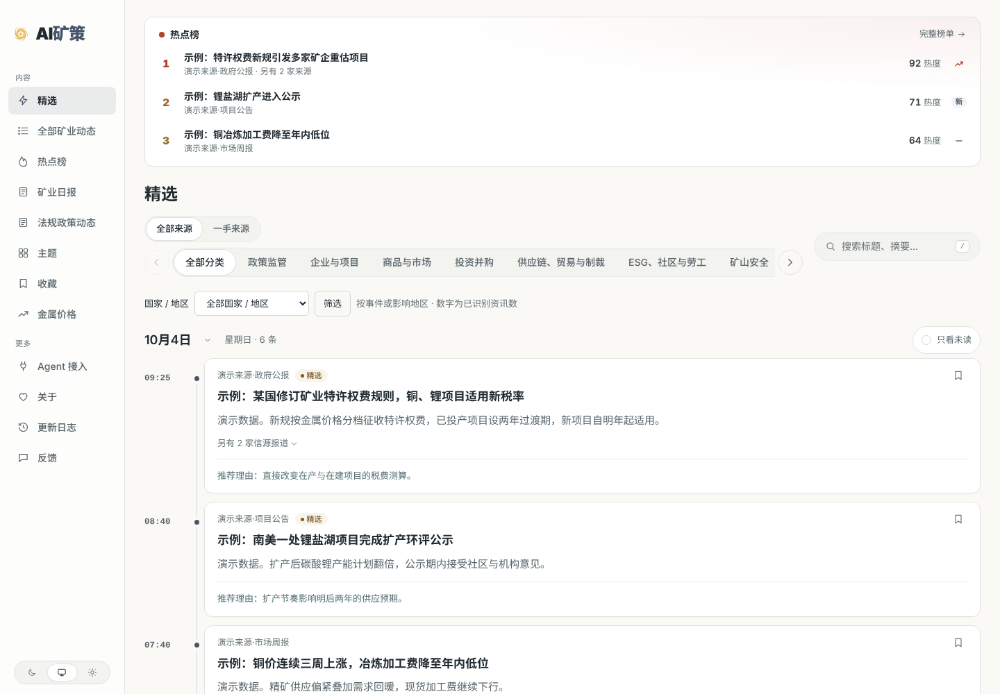
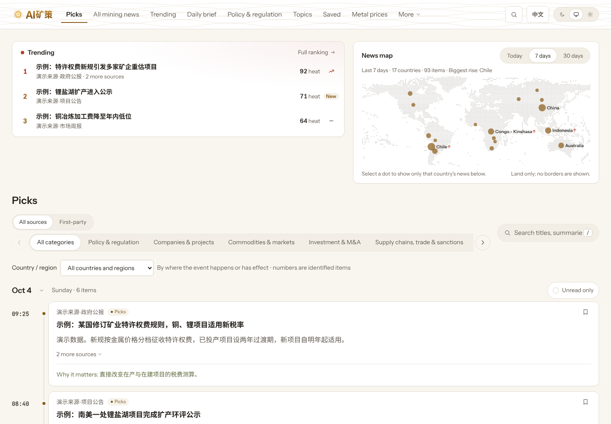

<p align="center"></p>
<h1 align="center">AI矿策 · AI Mining Policy</h1>
<p align="center">Noticias mineras del mundo, leídas como cambios claros</p>
<p align="center"><a href="README.md">English</a> · <a href="README.zh-CN.md">简体中文</a> · <b>Español</b> · <a href="README.fr.md">Français</a></p>
<p align="center"><a href="https://aiminingpolicy.com/">Abrir el sitio</a> · <a href="https://aiminingpolicy.com/all">Todas las noticias</a> · <a href="https://aiminingpolicy.com/daily">Boletín diario</a> · <a href="https://aiminingpolicy.com/agent">Para agentes</a> · <a href="https://aiminingpolicy.com/changelog">Registro de cambios</a></p>

<!-- readme-translation: README.md @ 3323964 -->
<p align="center"><sub>Traducido del texto fuente en inglés <code>README.md</code> (commit 3323964). Si difieren, prevalece el texto en inglés. Pendiente de revisión por un hablante nativo.</sub></p>

Los comunicados de las empresas, los avisos de los reguladores y la prensa internacional suelen contar el mismo hecho, dispersos en sitios e idiomas distintos. AI矿策 los recopila, redacta para cada uno un título y un resumen en chino, y conserva la fuente y el enlace al original, para que los lectores dediquen menos tiempo a buscar noticias y más a valorarlas.

No hace falta registrarse. Se lee de inmediato, y siempre se puede volver al original para comprobar.

<picture>
  <source media="(prefers-color-scheme: dark)" srcset="docs/assets/reader-preview/reader-dark.png">
  
</picture>
<p align="center"><sub>Captura de la página real con datos de demostración sintéticos.</sub></p>

## Para qué sirve el sitio

AI矿策 ayuda a quienes siguen la minería a leer noticias más fiables en poco tiempo: qué ha cambiado para empresas, proyectos, mercados y normas, y con qué grado de certeza. Se centra en la minería metálica: exploración y recursos, construcción de proyectos, operaciones de las empresas, operaciones corporativas, mercados y comercio, seguridad minera, tecnología de procesamiento, y medio ambiente y comunidades. Cobre, oro, zinc, plata, litio, molibdeno, hierro y aluminio están dentro del alcance, igual que el litio de salares y salmueras.

## Qué se puede hacer en él

| Quiere saber | Empiece aquí |
|---|---|
| Qué ha cambiado hoy que merezca atención | [Selección](https://aiminingpolicy.com/) |
| Todo lo recopilado, por categoría, país o palabra clave | [Todas las noticias mineras](https://aiminingpolicy.com/all) |
| Qué hechos cubren varias fuentes independientes | [Tendencias](https://aiminingpolicy.com/hot) |
| Un día, una semana o un mes de una sola lectura | [Boletín diario](https://aiminingpolicy.com/daily) |
| Dónde están las noticias en el mundo, en el último día, semana o mes | El mapa de noticias de la portada |
| Empresas y temas a lo largo del tiempo | [Temas](https://aiminingpolicy.com/topics) |
| Los últimos precios disponibles de los metales y su variación | [Precios de metales](https://aiminingpolicy.com/metals) |
| Leer más tarde | [Guardados](https://aiminingpolicy.com/starred) |

Cada noticia se lee una sola vez. El sistema distingue entre el mismo hecho, una novedad posterior, un hecho no relacionado y una recopilación: una noticia que solo cambia de titular, de idioma o de redacción no se convierte en una nueva selección, mientras que un hecho realmente nuevo se conserva como novedad del mismo acontecimiento. Las tendencias cuentan editores independientes, de modo que varios canales de una misma organización no las inflan.

## Idioma del contenido

El contenido del sitio está en chino: títulos, resúmenes y los motivos de cada selección. Cada elemento enlaza a su fuente original, en su idioma original. La interfaz está disponible en chino y, en [`/en`](https://aiminingpolicy.com/en), en inglés; la interfaz en inglés no traduce las noticias.


<p align="center"><sub>La interfaz en inglés con datos de demostración sintéticos.</sub></p>

## Políticas y normativa

La sección de **políticas y normativa** ha detenido sus actualizaciones automáticas por motivos de coste y técnicos. Su entrada y el contenido ya publicado siguen disponibles; la sección se está reconstruyendo en torno a los instrumentos jurídicos y su ciclo de vida, y su regreso se anunciará en el registro de cambios del sitio.

## Identificación de la IA y aviso

Los títulos, resúmenes, motivos e interpretaciones se redactan con ayuda de IA y así se indica en el sitio. Pueden contener errores u omisiones: compruebe siempre el original antes de basarse en ellos. Nada de lo publicado constituye asesoramiento jurídico, de inversión ni profesional. Cada página ofrece una vía para solicitar correcciones o la retirada de contenido.

## Para sus propias herramientas

El contenido público también está disponible para lectores RSS, programas y agentes de IA. Los puntos de entrada, las capacidades y los ejemplos se reúnen en la [página para agentes](https://aiminingpolicy.com/agent).

| Vía | Punto de entrada |
|---|---|
| API pública | `/api/v3` |
| Descripción de la API | `/openapi-v3.json` |
| RSS | `/feed.xml`, `/feed/all.xml`, `/feed/daily.xml`, `/feed/policies.xml` |
| MCP | `/api/mcp` |
| Notas de lectura para agentes | `/llms.txt` |

Solo leen contenido público y siguen las mismas reglas de retirada y permisos que el sitio. Un texto completo que el sitio puede mostrar no siempre puede redistribuirse; las interfaces respetan los permisos de cada fuente.

## Ejecutarlo en local

Necesita Node.js 24.11 o una versión 24.x posterior, y Docker Compose. En una copia nueva:

```bash
git clone https://github.com/Crhis-CP/AI-MINE.git
cd AI-MINE
node scripts/init-env.ts
docker compose up -d --build
```

El primer comando crea la configuración local y una contraseña de administrador, y se niega a sobrescribir un `.env` existente. Después, lea en `http://localhost:3000` e inicie sesión en la administración en `http://private.localhost:3000/admin` para configurar modelos y fuentes.

Para ver la parte del lector sin base de datos, modelos ni claves, inicie la API de demostración local, que solo sirve datos sintéticos, y conecte a ella el servidor de desarrollo web (dos terminales):

```bash
npm ci
node e2e/demo-api.ts
```

```bash
API_BASE_URL=http://127.0.0.1:3001 npm run dev --workspace @amp/web
```

Abra después `http://127.0.0.1:3000` (interfaz en chino) o `http://127.0.0.1:3000/en` (interfaz en inglés). El servidor web se niega a arrancar si su entorno contiene credenciales como tokens de la nube o de GitHub.

Para desarrollar, use el npm 11.19.0 fijado y las comprobaciones rápidas:

```bash
npm run check
```

`npm run check` es el subconjunto rápido. Para fusionar hace falta un comprobante completo de `make verify` de un ejecutor independiente que no sea de producción. Lea [CONTRIBUTING.md](CONTRIBUTING.md) y [AGENTS.md](AGENTS.md) antes de empezar desde una ficha de tarea.

## Desplegar su propia copia

Cualquiera puede desplegar el proyecto. La información propia de cada despliegue es configuración, no código:

- **Números de registro y de licencia.** El número de registro ICP, el número de registro de seguridad pública y el número de licencia del servicio de noticias en internet se leen de `SITE_ICP_FILING`, `SITE_PUBLIC_SECURITY_FILING` y `SITE_NEWS_LICENSE`. Si se dejan vacíos, no se muestra nada. Un despliegue en China continental debe rellenarlos y fijar `SITE_REQUIRE_FILINGS=true`, para que el servicio no arranque sin ellos. Véase [`.env.example`](.env.example).
- **Dominio y rutas.** La dirección del sitio y el directorio de instalación son parámetros del despliegue; véase [el script de publicación](deploy/production-release.sh).
- **Modelos y claves.** Los proveedores, nombres y claves de los modelos se introducen en la administración protegida, nunca en el código, los registros ni las capturas. Los costes registran por separado los aciertos de caché cuando el proveedor los factura aparte.
- **Mapas.** El mapa de noticias dibuja la tierra firme como puntos a partir de datos de Natural Earth, sin fronteras. Compruebe las normas sobre mapas del lugar donde publique antes de mostrar cualquier mapa.

## Dónde buscar

| Lugar | Contenido |
|---|---|
| [Paquete del sector](industry/README.md) | Marca, categorías, empresas, jurisdicciones, instrucciones y fuentes |
| [Notas del backend](packages/backend/README.md) | Procesamiento, acontecimientos, publicación, modelos y operación |
| [Registro de decisiones](docs/00-decision-ledger.md) | Decisiones de negocio y técnicas confirmadas |
| [Verificación](scripts/verify/README.md) | Comprobaciones completas y comprobantes |
| [Publicación](deploy/production-release.sh) | Publicación con bloqueo, migraciones y comprobaciones de salud |
| [Glosario del README](docs/i18n/readme-glossary.md) | Términos comunes a los cuatro idiomas del README |

¿Ha encontrado un error o conoce una fuente que valga la pena añadir? Use la [página de comentarios](https://aiminingpolicy.com/feedback) del sitio o abra una incidencia. Un enlace al original y el problema concreto facilitan la comprobación.

## Contribuciones y licencia

Gracias a todas las personas que seleccionan fuentes, informan de problemas y mejoran el código y la documentación. El proyecto usa herramientas de IA para ayudar a desarrollar, probar y revisar; los cambios quedan registrados en los commits y las pull requests.

El código se publica bajo la [licencia MIT](LICENSE). Los derechos de autor, las licencias y la procedencia del código y los recursos incluidos figuran en [NOTICE](NOTICE) y [UPSTREAM.md](UPSTREAM.md). Los derechos sobre los originales de las noticias, las imágenes y los adjuntos pertenecen a sus titulares.
