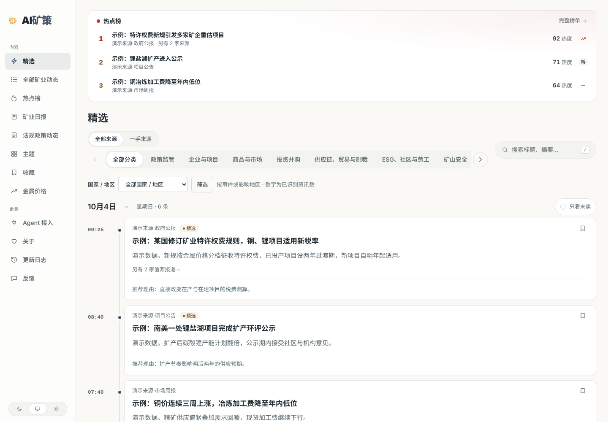
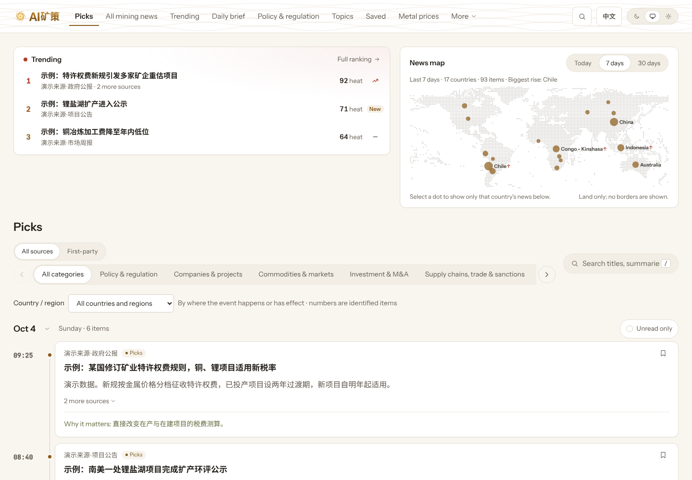

<p align="center"></p>
<h1 align="center">AI矿策 · AI Mining Policy</h1>
<p align="center">L’actualité minière mondiale, lue comme des changements clairs</p>
<p align="center"><a href="README.md">English</a> · <a href="README.zh-CN.md">简体中文</a> · <a href="README.es.md">Español</a> · <b>Français</b></p>
<p align="center"><a href="https://aiminingpolicy.com/">Ouvrir le site</a> · <a href="https://aiminingpolicy.com/all">Toutes les actualités</a> · <a href="https://aiminingpolicy.com/daily">Bulletin quotidien</a> · <a href="https://aiminingpolicy.com/agent">Pour les agents</a> · <a href="https://aiminingpolicy.com/changelog">Journal des modifications</a></p>

<!-- readme-translation: README.md @ 3323964 -->
<p align="center"><sub>Traduit du texte source anglais <code>README.md</code> (commit 3323964). En cas de divergence, le texte anglais fait foi. En attente de relecture par un locuteur natif.</sub></p>

Les annonces des entreprises, les avis des régulateurs et la presse internationale racontent souvent le même événement, dispersés entre sites et langues. AI矿策 les rassemble, rédige pour chacun un titre et un résumé en chinois, et conserve la source et le lien vers l’original, afin que les lecteurs passent moins de temps à chercher l’information et davantage à la juger.

Aucune inscription n’est nécessaire. On lit tout de suite, et l’on peut toujours revenir à l’original pour vérifier.

<picture>
  <source media="(prefers-color-scheme: dark)" srcset="docs/assets/reader-preview/reader-dark.png">
  
</picture>
<p align="center"><sub>Capture de la page réelle avec des données de démonstration synthétiques.</sub></p>

## À quoi sert le site

AI矿策 aide celles et ceux qui suivent le secteur minier à lire une information plus fiable en peu de temps : ce qui a changé pour les entreprises, les projets, les marchés et les règles, et avec quel degré de certitude. Le site se concentre sur les mines métalliques : exploration et ressources, construction de projets, activité des entreprises, fusions et acquisitions, marchés et commerce, sécurité minière, technologies de traitement, ainsi qu’environnement et communautés. Cuivre, or, zinc, argent, lithium, molybdène, fer et aluminium entrent dans le périmètre, de même que le lithium des salars et des saumures.

## Ce que l’on peut y faire

| Vous voulez savoir | Commencez ici |
|---|---|
| Ce qui a changé aujourd’hui et mérite l’attention | [Sélection](https://aiminingpolicy.com/) |
| Tout ce qui a été collecté, par catégorie, pays ou mot-clé | [Toutes les actualités minières](https://aiminingpolicy.com/all) |
| Quels événements sont couverts par plusieurs sources indépendantes | [Tendances](https://aiminingpolicy.com/hot) |
| Une journée, une semaine ou un mois en une seule lecture | [Bulletin quotidien](https://aiminingpolicy.com/daily) |
| Où se situe l’actualité dans le monde, sur le dernier jour, la dernière semaine ou le dernier mois | La carte des actualités en page d’accueil |
| Les entreprises et les thèmes dans la durée | [Thèmes](https://aiminingpolicy.com/topics) |
| Les derniers prix disponibles des métaux et leur évolution | [Prix des métaux](https://aiminingpolicy.com/metals) |
| Lire plus tard | [Enregistrés](https://aiminingpolicy.com/starred) |

Une même information ne se lit qu’une fois. Le système distingue le même fait, un développement ultérieur, un événement sans rapport et un article de synthèse : une information qui ne change que de titre, de langue ou de formulation ne devient pas une nouvelle sélection, tandis qu’un fait réellement nouveau est conservé comme développement du même événement. Les tendances comptent les éditeurs indépendants, si bien que plusieurs canaux d’une même organisation ne les gonflent pas.

## Langue du contenu

Le contenu du site est en chinois : titres, résumés et raisons de chaque sélection. Chaque élément renvoie à sa source d’origine, dans sa langue d’origine. L’interface existe en chinois et, sous [`/en`](https://aiminingpolicy.com/en), en anglais ; l’interface anglaise ne traduit pas les actualités elles-mêmes.


<p align="center"><sub>L’interface anglaise avec des données de démonstration synthétiques.</sub></p>

## Politiques et réglementation

La rubrique **politiques et réglementation** a suspendu ses mises à jour automatiques pour des raisons de coût et des raisons techniques. Son entrée et les contenus déjà publiés restent accessibles ; la rubrique est en cours de reconstruction autour des instruments juridiques et de leur cycle de vie, et son retour sera annoncé dans le journal des modifications du site.

## Signalement de l’IA et avertissement

Les titres, résumés, raisons et interprétations sont rédigés avec l’aide de l’IA et signalés comme tels sur le site. Ils peuvent être erronés ou incomplets : vérifiez toujours l’original avant de vous y fier. Rien sur le site ne constitue un conseil juridique, financier ou professionnel. Chaque page propose un moyen de demander une correction ou un retrait.

## Pour vos propres outils

Le contenu public est également accessible aux lecteurs RSS, aux programmes et aux agents d’IA. Les points d’entrée, les fonctionnalités et des exemples sont réunis sur la [page pour les agents](https://aiminingpolicy.com/agent).

| Moyen | Point d’entrée |
|---|---|
| API publique | `/api/v3` |
| Description de l’API | `/openapi-v3.json` |
| RSS | `/feed.xml`, `/feed/all.xml`, `/feed/daily.xml`, `/feed/policies.xml` |
| MCP | `/api/mcp` |
| Notes de lecture pour les agents | `/llms.txt` |

Ces accès ne lisent que le contenu public et suivent les mêmes règles de retrait et d’autorisation que le site. Un texte intégral que le site peut afficher ne peut pas toujours être redistribué ; les interfaces respectent les autorisations de chaque source.

## L’exécuter en local

Il faut Node.js 24.11 ou une version 24.x ultérieure, ainsi que Docker Compose. Dans une copie neuve :

```bash
git clone https://github.com/Crhis-CP/AI-MINE.git
cd AI-MINE
node scripts/init-env.ts
docker compose up -d --build
```

La première commande crée la configuration locale et un mot de passe d’administration, et refuse d’écraser un `.env` existant. Lisez ensuite sur `http://localhost:3000` et connectez-vous à l’administration sur `http://private.localhost:3000/admin` pour configurer les modèles et les sources.

Pour voir la partie lecteur sans base de données, modèles ni clés, lancez l’API de démonstration locale, qui ne sert que des données synthétiques, et branchez-y le serveur de développement web (deux terminaux) :

```bash
npm ci
node e2e/demo-api.ts
```

```bash
API_BASE_URL=http://127.0.0.1:3001 npm run dev --workspace @amp/web
```

Ouvrez ensuite `http://127.0.0.1:3000` (interface chinoise) ou `http://127.0.0.1:3000/en` (interface anglaise). Le serveur web refuse de démarrer si son environnement contient des identifiants comme des jetons d’accès cloud ou GitHub.

Pour développer, utilisez le npm 11.19.0 épinglé et les vérifications rapides :

```bash
npm run check
```

`npm run check` est le sous-ensemble rapide. Une fusion exige un reçu complet de `make verify` provenant d’un exécuteur indépendant, hors production. Lisez [CONTRIBUTING.md](CONTRIBUTING.md) et [AGENTS.md](AGENTS.md) avant de partir d’une fiche de tâche.

## Déployer votre propre copie

Tout le monde peut déployer le projet. Les informations propres à chaque déploiement relèvent de la configuration, pas du code :

- **Numéros d’enregistrement et de licence.** Le numéro d’enregistrement ICP, le numéro d’enregistrement auprès de la sécurité publique et le numéro de licence du service d’information en ligne sont lus dans `SITE_ICP_FILING`, `SITE_PUBLIC_SECURITY_FILING` et `SITE_NEWS_LICENSE`. Laissés vides, rien ne s’affiche. Un déploiement en Chine continentale doit les renseigner et définir `SITE_REQUIRE_FILINGS=true`, afin que le service refuse de démarrer sans eux. Voir [`.env.example`](.env.example).
- **Domaine et chemins.** L’adresse du site et le répertoire d’installation sont des paramètres de déploiement ; voir [le script de publication](deploy/production-release.sh).
- **Modèles et clés.** Les fournisseurs, noms et clés des modèles se saisissent dans l’administration protégée, jamais dans le code, les journaux ni les captures. Les coûts enregistrent à part les accès au cache lorsque le fournisseur les facture séparément.
- **Cartes.** La carte des actualités dessine les terres émergées en points à partir des données Natural Earth, sans frontières. Vérifiez les règles applicables aux cartes là où vous publiez avant d’afficher une carte.

## Où chercher

| Emplacement | Contenu |
|---|---|
| [Paquet sectoriel](industry/README.md) | Marque, catégories, entreprises, juridictions, consignes et sources |
| [Notes du backend](packages/backend/README.md) | Traitement, événements, publication, modèles et exploitation |
| [Registre des décisions](docs/00-decision-ledger.md) | Choix métier et techniques confirmés |
| [Vérification](scripts/verify/README.md) | Vérifications complètes et reçus |
| [Publication](deploy/production-release.sh) | Publication verrouillée, migrations et contrôles de santé |
| [Glossaire du README](docs/i18n/readme-glossary.md) | Termes communs aux quatre langues du README |

Vous avez trouvé une erreur ou connaissez une source à ajouter ? Utilisez la [page de commentaires](https://aiminingpolicy.com/feedback) du site ou ouvrez un ticket. Un lien vers l’original et le problème précis facilitent la vérification.

## Contributions et licence

Merci à toutes les personnes qui sélectionnent des sources, signalent des problèmes et améliorent le code et la documentation. Le projet utilise des outils d’IA pour aider au développement, aux tests et aux revues ; les modifications sont consignées dans les commits et les pull requests.

Le code est publié sous [licence MIT](LICENSE). Les droits d’auteur, licences et provenances du code et des ressources inclus figurent dans [NOTICE](NOTICE) et [UPSTREAM.md](UPSTREAM.md). Les droits sur les originaux des actualités, les images et les pièces jointes appartiennent à leurs titulaires.
