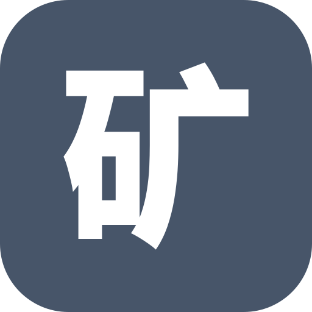
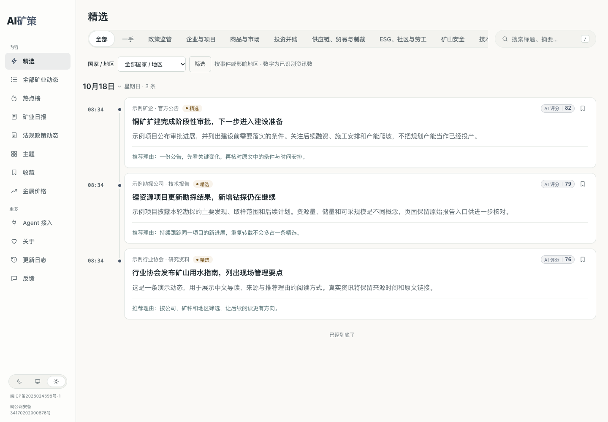
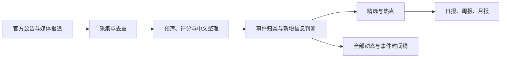
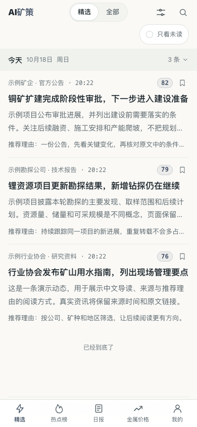
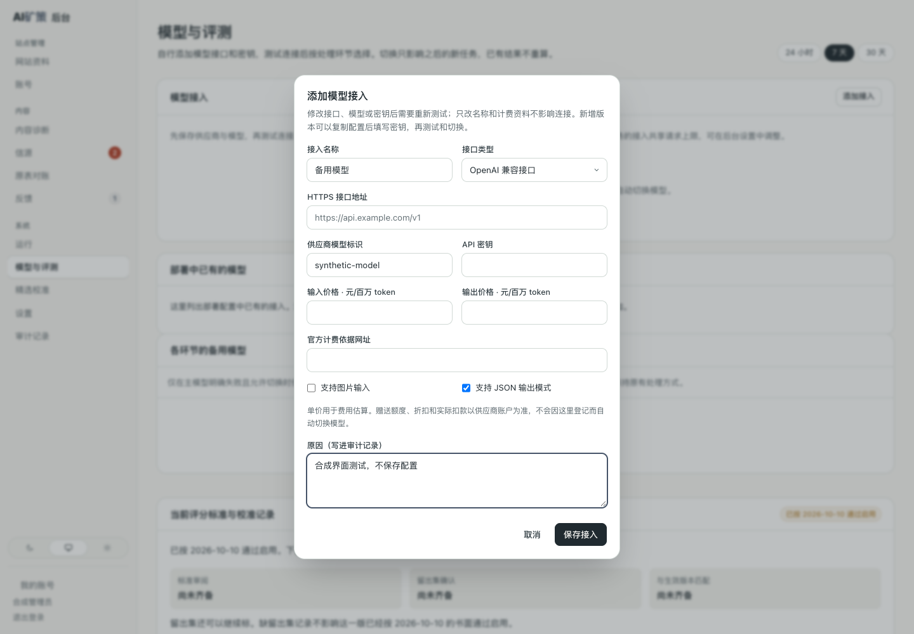

<p align="center"></p>
<h1 align="center">AI矿策</h1>
<p align="center">全球矿业资讯 · 把分散的消息，读成清楚的变化</p>
<p align="center"><a href="https://aiminingpolicy.com/">打开网站</a> · <a href="https://aiminingpolicy.com/all">全部动态</a> · <a href="https://aiminingpolicy.com/daily">矿业日报</a> · <a href="https://aiminingpolicy.com/agent">Agent 接入</a> · <a href="https://aiminingpolicy.com/changelog">更新日志</a></p>

矿企的公告、监管部门的通知、海外媒体的报道，往往说着同一件事，却散在不同的网站和语言里。AI矿策把这些信息收进来，整理成中文，保留来源和原文链接，让你少花时间找消息，把精力留给判断。

不用注册。打开就能读，想核对时可以回到原文。

> 本分支正在准备一次统一升级。下文介绍这次版本的功能与使用方式；正式站的实际发布以网站更新日志为准。实施和验收状态见[升级清单](docs/acceptance/major-upgrade-status.md)。

<picture>
  <source media="(prefers-color-scheme: dark)" srcset="docs/assets/reader-preview/reader-dark.png">
  
</picture>
<p align="center"><sub>截图来自本地实际页面，使用演示数据；不代表正式站已经完成本次升级。</sub></p>

## 从今天发生了什么开始

有几分钟，先看**精选**：哪家公司披露了新项目，哪项政策改变了经营条件，哪个矿山出现了值得关注的进展。每条都说明发生了什么、为什么值得看。

想把消息看全，打开**全部矿业动态**；想知道哪些事正被多家来源关注，去看**热点榜**。同一新闻的不同报道归在一起，后续进展继续留在同一个事件里。你可以展开来源，也可以顺着时间线读下去。

只想集中读一遍，就看**日报、周报或月报**。关心特定公司、矿种和地区，可以用搜索、筛选和主题页继续追踪。

| 你想了解 | 从这里开始 |
|---|---|
| 今天有哪些值得关注的变化 | [精选](https://aiminingpolicy.com/) |
| 看完整收录，按分类、地区或关键词查找 | [全部矿业动态](https://aiminingpolicy.com/all) |
| 哪些事件被多家独立来源报道 | [热点榜](https://aiminingpolicy.com/hot) |
| 集中回顾一天、一周或一个月 | [矿业日报](https://aiminingpolicy.com/daily) |
| 持续追踪公司和方向 | [主题](https://aiminingpolicy.com/topics) |
| 看金属最新可取得的报价及上一期变化 | [金属价格](https://aiminingpolicy.com/metals) |
| 以后再读 | [收藏](https://aiminingpolicy.com/starred) |

关注范围以金属矿业为主，覆盖资源勘探、项目建设、企业经营、交易并购、市场贸易、矿山安全、技术冶炼以及环境和社区。铜、金、锌、银、锂、钼、铁、铝等都在范围内；盐湖与卤水提锂同样关注。

## 同一新闻，读一次就够了

官网发了公告，媒体做了报道，地方协会又转了一遍——来源多了，新闻未必多了。

系统区分**同一事实、后续进展、无关事件和综合稿**。仅仅换了标题、语言或说法的内容，不会再作为一条新精选；真正新增的事实会作为进展保留下来。事件页保留各家报道，方便你核对不同视角。

热点按独立参与方计算，同一机构的多个入口和重复抓取不会反复增加热度。热度说明报道活跃程度，重要性仍需结合具体内容判断。



## 中文读懂，也能核对原文

外文资讯先提供中文标题和导读，合格且获准展示全文的精选再由后台补充翻译。翻译尚未完成、只有部分内容或来源不允许展示全文时，页面会如实说明。打开文章不会触发新的付费模型调用。

只有日期的来源就显示日期，未知时间保持未知。金属价格显示真实报价日期和比较基期：如果来源还没有发布新价格，页面不会把昨天的报价标成今天。

收藏、阅读位置和外观设置保存在自己的浏览器里。电脑和手机都可以阅读：长文可以直接跳到章节，正文图片可以放大查看。想把一条资讯发给朋友，可以复制链接，也可以保存带来源和二维码的分享图片。

<details>
<summary>看看手机上的阅读方式</summary>
<p align="center"></p>
<p align="center"><sub>本地演示数据与手机布局截图。</sub></p>
</details>

**法规政策动态**保留独立入口和已有内容。本次统一升级上线时，将因成本和技术问题暂时停止自动更新，后续重新建设并上线；届时会单独发布更新说明。

## 让自己的工具一起读

公开内容也提供给 RSS 阅读器、程序和 AI Agent。入口、可用能力及示例集中在 [Agent 接入页](https://aiminingpolicy.com/agent)。

| 方式 | 入口 |
|---|---|
| 公开 API | `/api/v3` |
| 接口文档 | `/openapi-v3.json` |
| RSS | `/feed.xml`、`/feed/all.xml`、`/feed/daily.xml`、`/feed/policies.xml` |
| MCP | `/api/mcp` |
| Agent 阅读说明 | `/llms.txt` |

这些入口只读取已公开内容，遵守相同的撤回与内容权限规则。网站允许阅读的全文，也可能不允许向外再分发；接口会按来源权限提供相应内容。

## 运营时，可以自己选模型

登录 `/admin` 后，可以管理来源、预览采集结果、查看内容诊断、修正归属、处理失败任务，以及查看请求和费用记录。

模型按处理环节配置。你可以自行添加兼容接口、填写模型名称或版本、录入密钥，测试连接后选择使用；也可以复制一份配置试用新版本。修改设置只影响后续工作，已有内容不会因此全部重算。

<details>
<summary>看看后台怎样添加模型</summary>

<p><sub>本地界面演示，未填写真实密钥，也未发起真实模型调用。</sub></p>
</details>

费用保留实际与估算的区别。服务按请求次数限流，已经得到的结果优先复用；结果未知的调用保留回执，按恢复规则处理。人为暂停的工作需要明确恢复，自动补处理不会替你解除暂停。

密钥只在受保护的后台录入，不写入聊天、代码、截图或公开日志。

## 本地运行与开发

需要 Node.js 24 和 Docker。以下命令用于全新的本地环境：

```bash
git clone https://github.com/Crhis-CP/AI-MINE.git
cd AI-MINE
node scripts/init-env.ts
docker compose up -d --build
```

初始化会生成本地配置和管理员密码，并拒绝覆盖已有 `.env`。启动后打开 `http://localhost:3000`，在后台完成模型及来源配置。来源是否启用、是否允许处理和展示全文，要分别核对；没有有效内容时保留空态。

参与代码开发时使用仓库固定的 npm 版本：

```bash
npm ci
npm run check
```

`npm run check` 是快速检查。合并需要独立非生产执行器上的完整 `make verify` 回执，生产发布另按固定流程执行。阅读[贡献指南](CONTRIBUTING.md)和 [AGENTS.md](AGENTS.md) 后，再从对应任务卡开始。

## 往哪里找

| 位置 | 内容 |
|---|---|
| [行业包](industry/README.md) | 品牌、分类、公司、法域、提示词和来源配置 |
| [后端说明](packages/backend/README.md) | 内容处理、事件、发布、模型和运行机制 |
| [升级清单](docs/acceptance/major-upgrade-status.md) | 当前改造、验证与尚未完成事项 |
| [决定记录](docs/00-decision-ledger.md) | 已确认的业务与技术取舍 |
| [统一验证](scripts/verify/README.md) | 完整检查与回执要求 |
| [正式发布](deploy/production-release.sh) | 持锁发布、迁移与健康检查 |
| [版本保留](docs/runbooks/release-retention.md) | 现役版本与必要回退版本的保留 |

发现错误或有希望增加的来源，可以使用网站[反馈入口](https://aiminingpolicy.com/feedback)，也可以在仓库提出 Issue。提供原文链接和具体问题，会更容易核对。

## 贡献与许可

感谢参与来源整理、问题反馈、代码和文档改进的人。项目使用 Codex 等工具辅助开发、测试和审查，具体变更记录在提交与 Pull Request 中。

代码使用 [MIT 许可](LICENSE)。所包含代码及素材的版权、许可和来源登记见 [NOTICE](NOTICE) 与 [UPSTREAM.md](UPSTREAM.md)。新闻原文、图片和附件的使用权限由各自权利人决定。
