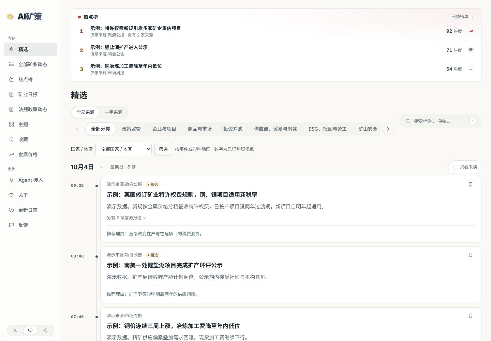
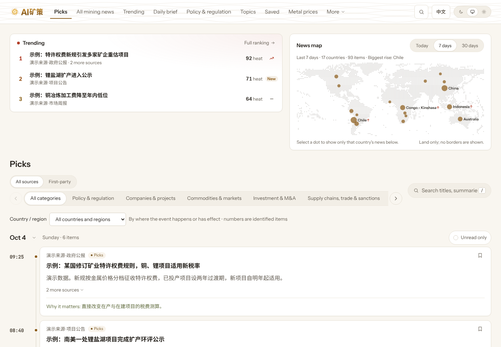

<p align="center"></p>
<h1 align="center">AI矿策 · AI Mining Policy</h1>
<p align="center">Global mining news, read as clear changes</p>
<p align="center"><b>English</b> · <a href="README.zh-CN.md">简体中文</a> · <a href="README.es.md">Español</a> · <a href="README.fr.md">Français</a></p>
<p align="center"><a href="https://aiminingpolicy.com/">Open the site</a> · <a href="https://aiminingpolicy.com/all">All news</a> · <a href="https://aiminingpolicy.com/daily">Daily brief</a> · <a href="https://aiminingpolicy.com/agent">For agents</a> · <a href="https://aiminingpolicy.com/changelog">Changelog</a></p>

<!-- readme-source: this file is the source text; the other languages name the commit they translate. -->

Company announcements, regulators' notices and overseas reporting often describe the same event, scattered across sites and languages. AI矿策 collects them, writes a Chinese title and summary for each, and keeps the source and the link to the original, so readers spend less time finding news and more time judging it.

No account is needed. Read straight away, and go back to the original whenever you want to check.

<picture>
  <source media="(prefers-color-scheme: dark)" srcset="docs/assets/reader-preview/reader-dark.png">
  
</picture>
<p align="center"><sub>Screenshot of the real page with synthetic demo data.</sub></p>

## What the site is for

AI矿策 helps people who follow mining read more reliable news in limited time: what changed for companies, projects, markets and rules, and how sure we can be about it. It is focused on metal mining: exploration and resources, project construction, company operations, deals, markets and trade, mine safety, processing technology, and environment and communities. Copper, gold, zinc, silver, lithium, molybdenum, iron and aluminium are all in scope, as is lithium from salt lakes and brines.

## What you can do on it

| You want to know | Start here |
|---|---|
| What changed today that is worth attention | [Picks](https://aiminingpolicy.com/) |
| Everything collected, by category, country or keyword | [All mining news](https://aiminingpolicy.com/all) |
| Which events several independent sources are covering | [Trending](https://aiminingpolicy.com/hot) |
| A day, a week or a month in one read | [Daily brief](https://aiminingpolicy.com/daily) |
| Where in the world the news is, over the last day, week or month | The news map on the home page |
| Companies and themes over time | [Topics](https://aiminingpolicy.com/topics) |
| The latest available metal prices and their change | [Metal prices](https://aiminingpolicy.com/metals) |
| Reading later | [Saved](https://aiminingpolicy.com/starred) |

One story is read once. The system tells apart the same fact, a later development, an unrelated event and a round-up: a story that only changed its headline, language or wording does not become a new pick, while a genuinely new fact is kept as a development of the same event. Trending counts independent publishers, so several feeds of one organisation do not inflate it.

## Content language

The site's content is in Chinese: titles, summaries and the reasons a story was picked. Every item links to its original source, in the original language. The interface is available in Chinese and, under [`/en`](https://aiminingpolicy.com/en), in English; the English interface does not translate the news itself.


<p align="center"><sub>The English interface with synthetic demo data.</sub></p>

## Policy and regulation

The **policy and regulation** line has stopped automatic updates for cost and technical reasons. Its entry and the content already published remain available; the line is being rebuilt around legal instruments and their life cycle, and its return will be announced on the site's changelog.

## AI labelling and disclaimer

Titles, summaries, reasons and interpretations are written with AI assistance and are labelled as such on the site. They can be wrong or incomplete: always check the original before relying on anything. Nothing on the site is legal, investment or professional advice. Each page offers a correction and takedown entry.

## For your own tools

Public content is also available to RSS readers, programs and AI agents. Entry points, capabilities and examples are collected on the [For agents page](https://aiminingpolicy.com/agent).

| Way | Entry point |
|---|---|
| Public API | `/api/v3` |
| API description | `/openapi-v3.json` |
| RSS | `/feed.xml`, `/feed/all.xml`, `/feed/daily.xml`, `/feed/policies.xml` |
| MCP | `/api/mcp` |
| Reading notes for agents | `/llms.txt` |

These only read public content and follow the same withdrawal and permission rules as the site. A full text the site may show is not always one it may redistribute; the interfaces honour each source's permissions.

## Run it locally

You need Node.js 24.11 or a later 24.x release, and Docker Compose. In a fresh checkout:

```bash
git clone https://github.com/Crhis-CP/AI-MINE.git
cd AI-MINE
node scripts/init-env.ts
docker compose up -d --build
```

The first command creates local settings and an administrator password and refuses to overwrite an existing `.env`. Then read at `http://localhost:3000` and sign in to the administration at `http://private.localhost:3000/admin` to configure models and sources.

To look at the reader without a database, models or keys, start the local demo API, which serves synthetic data only, and point the web development server at it (two terminals):

```bash
npm ci
node e2e/demo-api.ts
```

```bash
API_BASE_URL=http://127.0.0.1:3001 npm run dev --workspace @amp/web
```

Then open `http://127.0.0.1:3000` (Chinese interface) or `http://127.0.0.1:3000/en` (English interface). The web server refuses to start while credentials such as cloud or GitHub tokens are in its environment.

For development, use the pinned npm 11.19.0 and the quick checks:

```bash
npm run check
```

`npm run check` is the quick subset. Merging needs a full `make verify` receipt from an independent, non-production runner. Read [CONTRIBUTING.md](CONTRIBUTING.md) and [AGENTS.md](AGENTS.md) before starting from a task card.

## Deploying your own copy

Anyone may deploy the project. Deployment-specific information is configuration, not code:

- **Filing and licence numbers.** The ICP filing number, the public-security filing number and the internet news service licence number are read from `SITE_ICP_FILING`, `SITE_PUBLIC_SECURITY_FILING` and `SITE_NEWS_LICENSE`. Left empty, nothing is shown. A deployment in mainland China should set them and set `SITE_REQUIRE_FILINGS=true`, so the service refuses to start without them. See [`.env.example`](.env.example).
- **Domain and paths.** The site address and the install directory are deployment settings; see [the release script](deploy/production-release.sh).
- **Models and keys.** Model providers, names and keys are entered in the protected administration, never in code, logs or screenshots. Costs record cache hits separately where the provider prices them.
- **Maps.** The news map draws land as dots from Natural Earth data, with no borders. Check the map rules where you publish before showing any map.

## Where to look

| Place | Contents |
|---|---|
| [Industry pack](industry/README.md) | Brand, categories, companies, jurisdictions, prompts and sources |
| [Backend notes](packages/backend/README.md) | Processing, events, publication, models and operations |
| [Decision ledger](docs/00-decision-ledger.md) | Confirmed business and technical choices |
| [Verification](scripts/verify/README.md) | Full checks and receipts |
| [Release](deploy/production-release.sh) | Locked release, migrations and health checks |
| [README glossary](docs/i18n/readme-glossary.md) | Terms used across the four README languages |

Found a mistake, or know a source worth adding? Use the site's [feedback page](https://aiminingpolicy.com/feedback) or open an issue. A link to the original and the specific problem make it easier to check.

## Contributing and licence

Thanks to everyone who curates sources, reports problems, and improves code and documentation. The project uses AI tools to help develop, test and review; changes are recorded in commits and pull requests.

The code is under the [MIT licence](LICENSE). Copyright, licences and provenance of included code and assets are listed in [NOTICE](NOTICE) and [UPSTREAM.md](UPSTREAM.md). Rights to news originals, images and attachments belong to their owners.
