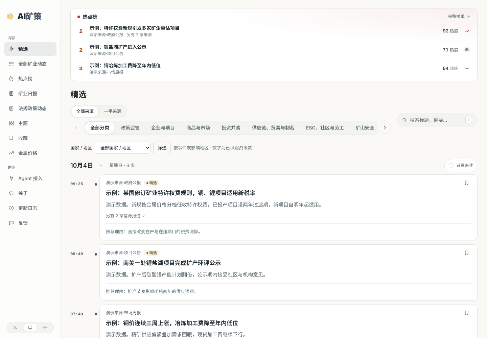
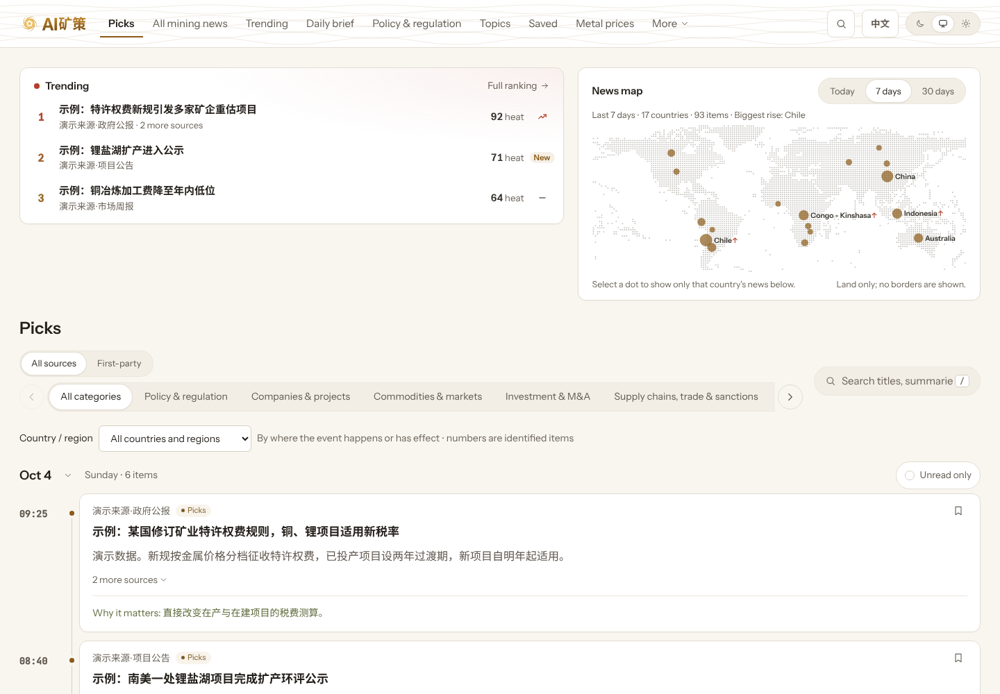

<p align="center"></p>
<h1 align="center">AI矿策 · AI Mining Policy</h1>
<p align="center">全球矿业资讯 · 把分散的消息，读成清楚的变化</p>
<p align="center"><a href="README.md">English</a> · <b>简体中文</b> · <a href="README.es.md">Español</a> · <a href="README.fr.md">Français</a></p>
<p align="center"><a href="https://aiminingpolicy.com/">打开网站</a> · <a href="https://aiminingpolicy.com/all">全部动态</a> · <a href="https://aiminingpolicy.com/daily">矿业日报</a> · <a href="https://aiminingpolicy.com/agent">Agent 接入</a> · <a href="https://aiminingpolicy.com/changelog">更新日志</a></p>

<!-- readme-translation: README.md @ 3323964 -->
<p align="center"><sub>本文译自英文源文 <code>README.md</code>（提交 3323964）。两者不一致时以英文源文为准。</sub></p>

矿企的公告、监管部门的通知、海外媒体的报道，往往说着同一件事，却散在不同的网站和语言里。AI矿策把这些信息收进来，为每条写好中文标题和导读，保留来源和原文链接，让你少花时间找消息，把精力留给判断。

不用注册。打开就能读，想核对时可以回到原文。

<picture>
  <source media="(prefers-color-scheme: dark)" srcset="docs/assets/reader-preview/reader-dark.png">
  
</picture>
<p align="center"><sub>截图来自本地实际页面，使用演示数据。</sub></p>

## 网站做什么

AI矿策帮助关心矿业的人，在有限的时间里读到更可靠的资讯：公司、项目、市场和规则发生了什么变化，以及这些说法有多可靠。关注范围以金属矿业为主，覆盖资源勘探、项目建设、企业经营、交易并购、市场贸易、矿山安全、技术冶炼以及环境和社区。铜、金、锌、银、锂、钼、铁、铝都在范围内，盐湖与卤水提锂同样关注。

## 能在网站上做什么

| 你想了解 | 从这里开始 |
|---|---|
| 今天有哪些值得关注的变化 | [精选](https://aiminingpolicy.com/) |
| 看完整收录，按分类、国家或关键词查找 | [全部矿业动态](https://aiminingpolicy.com/all) |
| 哪些事件被多家独立来源报道 | [热点榜](https://aiminingpolicy.com/hot) |
| 集中回顾一天、一周或一个月 | [矿业日报](https://aiminingpolicy.com/daily) |
| 近一天、一周或一个月，资讯集中在世界哪里 | 首页的资讯地图 |
| 持续追踪公司和方向 | [主题](https://aiminingpolicy.com/topics) |
| 金属最新可取得的报价及变化 | [金属价格](https://aiminingpolicy.com/metals) |
| 以后再读 | [收藏](https://aiminingpolicy.com/starred) |

同一新闻，读一次就够了。系统区分同一事实、后续进展、无关事件和综合稿：只换了标题、语言或说法的报道，不会再作为一条新精选；真正新增的事实会作为同一事件的进展保留下来。热点按独立发布方计算，同一机构的多个入口不会反复增加热度。

## 内容语言

网站内容是中文：标题、导读和推荐理由都是中文。每条都附原文链接，原文保持原来的语言。界面有中文和英文两种，英文界面在 [`/en`](https://aiminingpolicy.com/en)；英文界面不翻译资讯内容本身。


<p align="center"><sub>英文界面，使用演示数据。</sub></p>

## 法规与政策

**法规政策动态**因成本和技术问题暂时停止自动更新。独立入口和已发布内容继续保留。这条线正在以“法律文书及其生命周期”为单位重新建设，恢复时间会在网站更新日志中公告。

## AI 标识与免责声明

标题、导读、推荐理由和解读由 AI 辅助生成，网站上都有标注。它们可能有错或不完整，引用或决策前请先核对原文。网站内容不构成法律、投资或其他专业意见。每个页面都有更正与下架入口。

## 让自己的工具一起读

公开内容也提供给 RSS 阅读器、程序和 AI Agent。入口、可用能力和示例集中在 [Agent 接入页](https://aiminingpolicy.com/agent)。

| 方式 | 入口 |
|---|---|
| 公开 API | `/api/v3` |
| 接口文档 | `/openapi-v3.json` |
| RSS | `/feed.xml`、`/feed/all.xml`、`/feed/daily.xml`、`/feed/policies.xml` |
| MCP | `/api/mcp` |
| Agent 阅读说明 | `/llms.txt` |

这些入口只读取已公开内容，遵守与网站相同的撤回和权限规则。网站可以展示的全文，不一定允许再分发；接口按各来源的权限提供内容。

## 本地运行

需要 Node.js 24.11 或更高的 24.x 版本，以及 Docker Compose。在全新的环境中：

```bash
git clone https://github.com/Crhis-CP/AI-MINE.git
cd AI-MINE
node scripts/init-env.ts
docker compose up -d --build
```

第一条命令会生成本地配置和管理员密码，并拒绝覆盖已有的 `.env`。之后在 `http://localhost:3000` 阅读，在 `http://private.localhost:3000/admin` 登录后台，配置模型和来源。

如果只想看读者端，不需要数据库、模型或密钥：启动只提供合成数据的本地演示 API，再让网页开发服务器连到它（两个终端）：

```bash
npm ci
node e2e/demo-api.ts
```

```bash
API_BASE_URL=http://127.0.0.1:3001 npm run dev --workspace @amp/web
```

然后打开 `http://127.0.0.1:3000`（中文界面）或 `http://127.0.0.1:3000/en`（英文界面）。环境里有云服务或 GitHub 令牌等凭据时，网页服务器会拒绝启动。

参与开发时使用仓库固定的 npm 11.19.0，运行快速检查：

```bash
npm run check
```

`npm run check` 是快速检查。合并需要独立的非生产执行器上完整的 `make verify` 回执。请先读 [CONTRIBUTING.md](CONTRIBUTING.md) 和 [AGENTS.md](AGENTS.md)，再从任务卡开始。

## 自行部署须知

任何人都可以部署本项目。和部署有关的信息都是配置，不写在代码里：

- **备案号与许可证编号。**ICP 备案号、公安联网备案号和互联网新闻信息服务许可证编号分别从 `SITE_ICP_FILING`、`SITE_PUBLIC_SECURITY_FILING`、`SITE_NEWS_LICENSE` 读取，不填就不显示。在中国大陆部署时应当填写，并设置 `SITE_REQUIRE_FILINGS=true`，缺号码时服务拒绝启动。见 [`.env.example`](.env.example)。
- **域名与路径。**网站地址和安装目录是部署设置，见[发布脚本](deploy/production-release.sh)。
- **模型与密钥。**模型服务商、名称和密钥在受保护的后台录入，不写进代码、日志或截图。服务商对缓存命中单独计价时，费用记录也分开计算。
- **地图。**资讯地图用 Natural Earth 数据把陆地画成点阵，不画国界。在你发布的地方展示任何地图之前，请先核对当地的地图规定。

## 往哪里找

| 位置 | 内容 |
|---|---|
| [行业包](industry/README.md) | 品牌、分类、公司、法域、提示词和来源 |
| [后端说明](packages/backend/README.md) | 内容处理、事件、发布、模型和运行 |
| [决定记录](docs/00-decision-ledger.md) | 已确认的业务与技术取舍 |
| [统一验证](scripts/verify/README.md) | 完整检查与回执 |
| [正式发布](deploy/production-release.sh) | 持锁发布、迁移与健康检查 |
| [README 术语表](docs/i18n/readme-glossary.md) | 四种语言 README 共用的术语 |

发现错误，或者有值得增加的来源？可以使用网站的[反馈入口](https://aiminingpolicy.com/feedback)，也可以在仓库提 Issue。附上原文链接和具体问题，会更容易核对。

## 贡献与许可

感谢参与来源整理、问题反馈、代码和文档改进的人。项目使用 AI 工具辅助开发、测试和审查，具体变更记录在提交与 Pull Request 中。

代码使用 [MIT 许可](LICENSE)。所包含代码及素材的版权、许可和来源登记见 [NOTICE](NOTICE) 与 [UPSTREAM.md](UPSTREAM.md)。新闻原文、图片和附件的使用权限由各自权利人决定。
